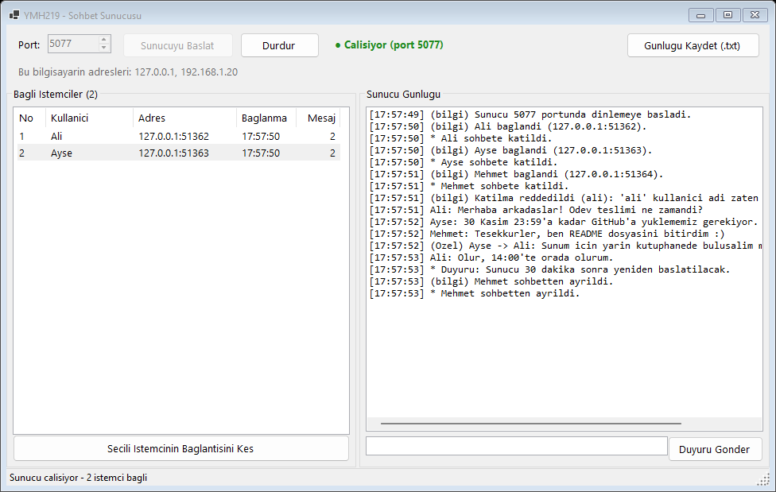
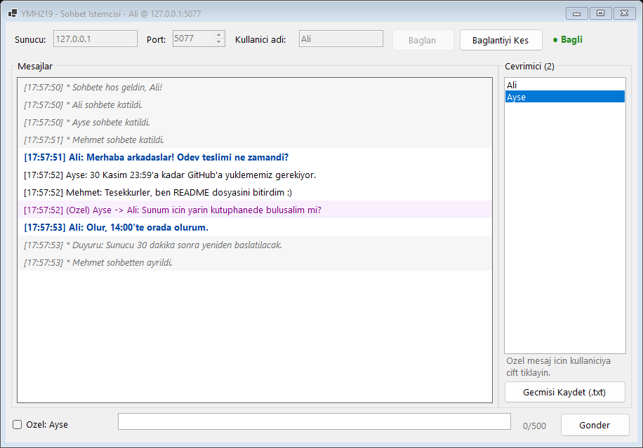
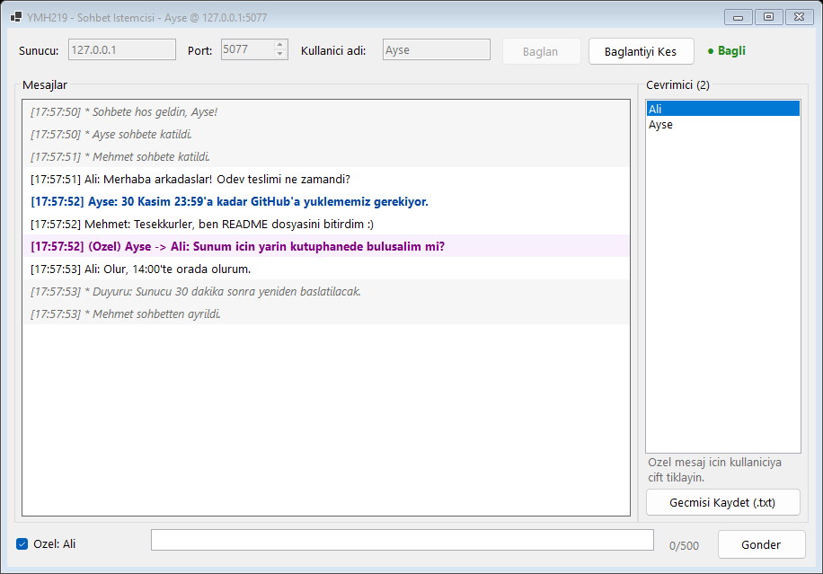
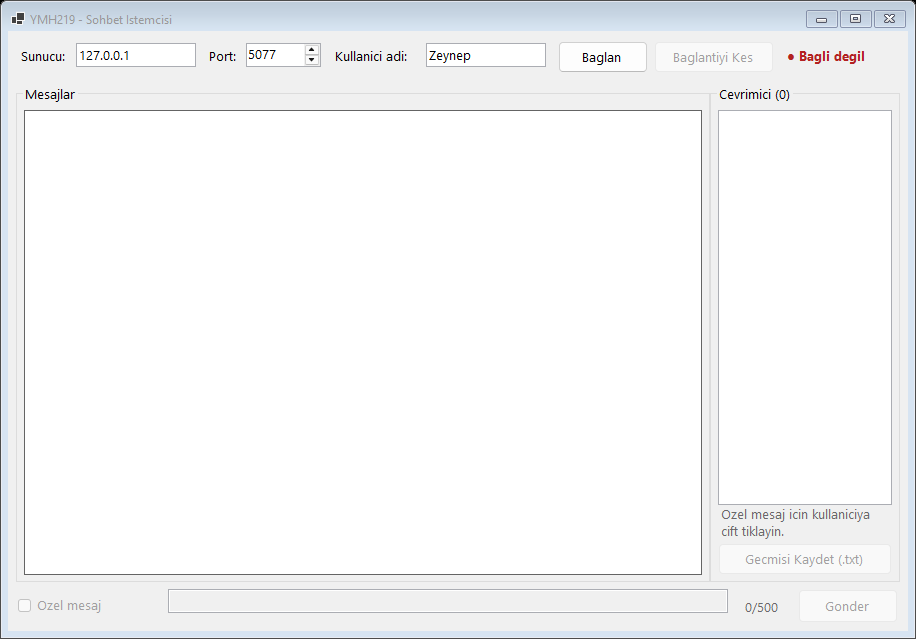

# YMH219 - İstemci-Sunucu Chat Uygulaması

Nesne Tabanlı Programlama (YMH 219) dersi ek uygulama ödevi kapsamında geliştirilmiş, **C# / .NET Windows Forms** ile yazılmış istemci-sunucu sohbet uygulaması.
Bir **sunucu** uygulaması `TcpListener` ile bağlantıları kabul eder; birden fazla **istemci** uygulaması `TcpClient` ile kullanıcı adıyla bağlanıp aynı sohbet odasında mesajlaşır. Tüm ağ işlemleri `async/await` ile yapılır, arayüz donmaz.

## Ekran Görüntüleri

| Sunucu (bağlı istemciler ve günlük) | İstemci - Ali |
|:---:|:---:|
|  |  |

| İstemci - Ayşe (özel mesaj modu) | Bağlantı öncesi istemci |
|:---:|:---:|
|  |  |

## Kullanılan Teknolojiler

- C# 14 / .NET 10 (`net10.0-windows`, sınıf kütüphanesi `net10.0`)
- Windows Forms
- `System.Net.Sockets` → `TcpListener`, `TcpClient`, `NetworkStream`
- `StreamReader` / `StreamWriter` ile satır tabanlı iletişim, `System.Text.Json` ile paket biçimi
- `async/await`, `CancellationToken`, `SemaphoreSlim`, `ConcurrentDictionary`
- Harici NuGet paketi kullanılmamıştır.

## Kurulum ve Çalıştırma

**Visual Studio ile:**
1. Depoyu klonlayın: `git clone https://github.com/Omerdoganse/YMH219-ChatApp.git`
2. `YMH219-ChatApp.sln` dosyasını Visual Studio 2022 (17.14+) / 2026 ile açın.
3. Çözüme sağ tıklayıp **Configure Startup Projects → Multiple startup projects** seçin; `ChatServer` ve `ChatClient` projelerini **Start** yapın.
4. `F5` ile çalıştırın. Ek istemci açmak için `ChatClient` projesine sağ tıklayıp **Debug → Start New Instance** seçin.

**Komut satırı ile** (her komutu ayrı bir terminalde çalıştırın):
```bash
cd YMH219-ChatApp
dotnet run --project ChatServer
dotnet run --project ChatClient
dotnet run --project ChatClient   # ikinci istemci
```

**Kullanım:**
1. Sunucu penceresinde portu seçip (varsayılan `5050`) **Sunucuyu Başlat**'a basın.
2. İstemcide sunucu adresini (aynı bilgisayar için `127.0.0.1`, yerel ağ için sunucu penceresinde yazan IP), portu ve kullanıcı adını girip **Bağlan**'a basın.
3. Mesajı yazıp **Enter** veya **Gönder** ile gönderin.

> .NET 10 SDK gereklidir: https://dotnet.microsoft.com/download
> Farklı bilgisayarlardan bağlanırken Windows Güvenlik Duvarı ilk çalıştırmada sunucu için izin isteyebilir.

## Temel Özellikler

**Sunucu**
- Port seçimi, **Başlat / Durdur** ve renkli çalışma durumu göstergesi.
- Aynı anda birden fazla istemci (her istemci ayrı bir asenkron görevde dinlenir).
- **Bağlı istemciler listesi:** numara, kullanıcı adı, IP:port, bağlanma saati ve gönderdiği mesaj sayısı.
- Zaman damgalı **sunucu günlüğü** (bağlanma, ayrılma, mesajlar, hatalar).
- Tüm istemcilere **duyuru** gönderme, seçili istemcinin **bağlantısını kesme**.
- Günlüğü `.txt` dosyasına kaydetme.

**İstemci**
- Sunucu adresi, port ve **kullanıcı adı** ile **Bağlan**, **Gönder**, **Bağlantıyı Kes**.
- Gönderilen ve alınan mesajlar `[SS:dd:ss]` **zaman bilgisiyle** gösterilir; kendi mesajlar mavi/kalın, sistem mesajları gri/italik, özel mesajlar mor.
- Çevrimiçi kullanıcı listesi (sunucudan anlık güncellenir).
- **Özel mesaj:** listede bir kullanıcıya çift tıklayın veya seçip *Özel* kutusunu işaretleyin; mesaj yalnızca o kişiye gider.
- **Mesaj geçmişini** `.txt` dosyasına kaydetme, karakter sayacı (en fazla 500).

**Hata kontrolleri** (uygulama kapanmaz, kullanıcıya anlaşılır mesaj gösterilir)
- Sunucu çalışmıyorsa / adres yanlışsa: *"Sunucuya bağlanılamadı ... Sunucunun çalıştığından emin olun."*
- 5 saniyede bağlanılamazsa zaman aşımı mesajı.
- Aynı kullanıcı adı zaten bağlıysa veya ad geçersizse sunucu katılmayı reddeder.
- Port kullanımdaysa sunucu başlatılamaz uyarısı.
- Sunucu kapanırsa veya bağlantı koparsa istemcide bildirim gösterilir, form bağlantısız duruma döner.
- Bozuk/JSON olmayan veri gelirse yok sayılır; bir istemcideki hata diğerlerini etkilemez.

## Proje Yapısı ve Sınıf Tasarımı

```
YMH219-ChatApp/
├── ChatApp.Core/                   # Ortak sınıf kütüphanesi (arayüzden bağımsız)
│   ├── Models/
│   │   ├── PacketType.cs           # Join, Message, PrivateMessage, UserList, System, Leave ...
│   │   ├── ChatPacket.cs           # Ağ paketi: gönderen, alıcı, metin, zaman damgası
│   │   └── ConnectedClientInfo.cs  # Sunucudaki istemci bilgisi (ad, IP, saat, mesaj sayısı)
│   ├── Protocol/
│   │   ├── PacketSerializer.cs     # Paket <-> tek satır JSON
│   │   ├── ChatRules.cs            # Kullanıcı adı / mesaj / port doğrulama kuralları
│   │   └── ChatException.cs        # Kullanıcıya gösterilecek anlaşılır hata türü
│   ├── Network/
│   │   ├── PacketConnection.cs     # TcpClient + StreamReader/Writer sarmalayıcı
│   │   ├── ChatServerService.cs    # TcpListener, çoklu istemci, yayın ve özel mesaj yönlendirme
│   │   └── ChatClientService.cs    # TcpClient, bağlan/gönder/kes, dinleme döngüsü
│   └── Services/
│       └── ChatHistoryService.cs   # Geçmişi/günlüğü .txt olarak kaydetme
├── ChatServer/                     # Sunucu WinForms uygulaması
│   ├── Program.cs
│   └── ServerForm.cs
└── ChatClient/                     # İstemci WinForms uygulaması
    ├── Program.cs
    ├── ClientForm.cs
    └── Controls/
        └── MessageListBox.cs       # Mesajları renklendiren özel ListBox
```

- **Katmanlı tasarım:** Ağ ve iş kuralları `ChatApp.Core` kütüphanesindedir; iki form da yalnızca bu servisleri kullanır. Böylece aynı kod hem sunucu hem istemci tarafında paylaşılır.
- **Kapsülleme:** Bağlantı nesneleri, oturum listesi ve kilitler servislerin içinde `private` tutulur; dışarıya `IsRunning`, `IsConnected`, `Clients` gibi salt okunur özellikler açılır. `MessageCount` yalnızca sunucu tarafından artırılabilir (`internal`).
- **Olaylar (event):** `ChatServerService` → `ClientConnected`, `ClientDisconnected`, `MessageRelayed`, `Log`; `ChatClientService` → `PacketReceived`, `UserListReceived`, `Disconnected`. Formlar bu olaylara abone olur ve `BeginInvoke` ile arayüzü UI iş parçacığında günceller.
- **Kalıtım / çok biçimlilik:** `MessageListBox`, `ListBox` sınıfından türer ve `OnDrawItem`, `OnMeasureItem`, `OnResize` metotlarını override eder. `ChatException`, `Exception` sınıfından türer.
- **Asenkron programlama:** Bağlanma, gönderme, dinleme ve kabul döngüleri `async/await` ile yazılmıştır; eşzamanlı yazmalar `SemaphoreSlim` ile sıraya konur.
- **Güvenlik önlemi:** Sunucu, gönderen adını ve zaman damgasını kendisi atar (istemci başkasının adına mesaj gönderemez).

### İletişim Protokolü

Her paket tek satırlık bir JSON metnidir ve `\n` ile ayrılır:
```json
{"Type":"Message","Sender":"Ali","Text":"Merhaba","Timestamp":"2026-11-23T17:57:51"}
```
Bağlantı akışı: `Join` → `JoinAccepted`/`JoinRejected` → `Message` / `PrivateMessage` ↔ sunucu yayını, `UserList`, `System` → `Leave`.

## Bilinen Sınırlamalar / Geliştirme Notları

- İletişim şifresizdir (TLS yok); yalnızca ders kapsamında aynı bilgisayarda veya güvenilir yerel ağda kullanılmalıdır.
- Tek bir ortak sohbet odası vardır; birden fazla oda desteği yoktur.
- Kimlik doğrulama (parola) yoktur, kullanıcı adı yalnızca oturum boyunca benzersizdir.
- Mesaj geçmişi yalnızca kullanıcı **Geçmişi Kaydet** dediğinde dosyaya yazılır; sunucu mesajları kalıcı olarak saklamaz.
- Ekran görüntüleri, aynı bilgisayarda çalışan bir sunucu ve üç istemciyle (Ali, Ayşe, Mehmet) alınmıştır; farklı bilgisayarlar arasında test yerel ağ ve güvenlik duvarı ayarlarına bağlıdır.

## Öğrenci Bilgileri

- **Ad Soyad:** Ömer Doğan
- **Öğrenci No:** 250541101
- **Ders:** Nesne Tabanlı Programlama (YMH 219)
